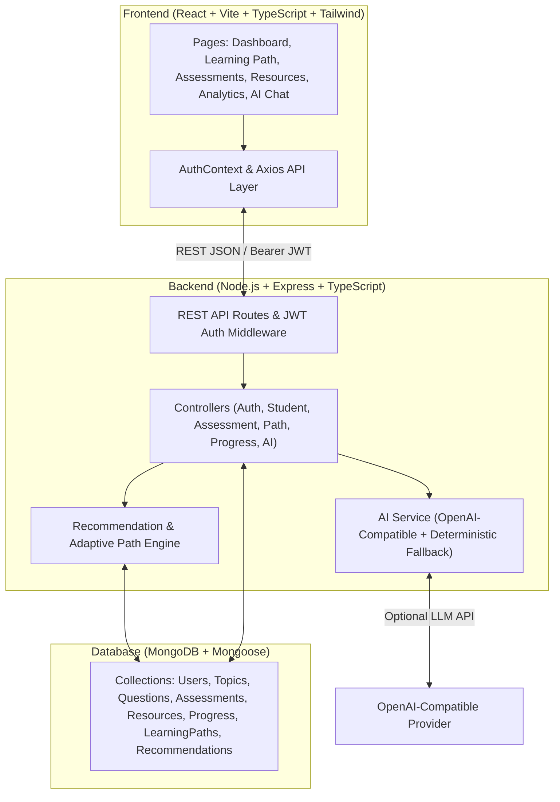

# NOMAD EDU — Personalized Adaptive Learning Platform

> **"Learning that adapts to you."**

NOMAD EDU is an AI-powered personalized and adaptive education platform that analyzes a student's performance, preferences, strengths, weaknesses, and learning pace to dynamically build and continuously adapt an individualized learning path. Designed to be practical for any learner while explicitly supporting low-resource educational environments.

---

## 1. Problem

Students have varying learning abilities, learning speeds, prerequisite gaps, and resource preferences — yet traditional learning management systems deliver identical content in a fixed sequence to everyone. Students who struggle with a foundational concept fall behind when forced forward, while advanced students lose engagement repeating material they have already mastered.

## 2. Solution

NOMAD implements a continuous closed-loop adaptive cycle:

```
ASSESS → UNDERSTAND → PERSONALIZE → LEARN → REASSESS → ADAPT
```

1. **Assess**: Diagnose baseline topic-level proficiency across subjects.
2. **Understand**: Analyze mastery scores, attempt counts, preferred learning formats (video, article, interactive, practice, PDF), and available study time.
3. **Personalize**: Construct a prerequisite-aware learning path that highlights the exact next topic the student needs.
4. **Learn**: Match curated learning resources to the student's preferred style and bandwidth constraints (`low`, `medium`, `high`).
5. **Reassess & Adapt**: Automatically recalculate mastery, unlock downstream topics once proficiency is reached ($\ge 80\%$), or recommend foundational review and alternative resource formats when a student struggles.

---

## 3. Key Features

- **Dynamic Learning Path Engine**: Visual timeline ordering topics by prerequisite chains and live mastery status (`completed`, `current`, `available`, `locked`).
- **Adaptive Assessments**: Topic-filtered and subject-wide assessments with instant grading, topic-level percentage breakdowns, and detailed explanations.
- **Context-Aware AI Learning Assistant**: Conversational tutor with real-time access to the student's mastery scores, weak topics, recent assessments, and active learning path — backed by deterministic fallback rules so the system works with 100% reliability even without an external LLM key.
- **Low-Resource & Accessibility First**: Every resource includes bandwidth indicators (`low` / `medium` / `high`) and accessibility tags, allowing students on constrained connections to filter for lightweight text and interactive materials.
- **Real-Time Analytics**: Interactive Recharts visualizations (score trends, subject mastery radar/bars, topic breakdowns) driven strictly by real MongoDB records.
- **One-Click Demo Mode**: Pre-seeded demo student (**Aarav**) ready for immediate 60–90 second live judge demonstrations.

---

## 4. Architecture



---

## 5. Tech Stack

- **Frontend**: React 18, Vite, TypeScript, Tailwind CSS, React Router v6, Recharts, Lucide React, Axios
- **Backend**: Node.js, Express, TypeScript, Mongoose, JSON Web Tokens (`jsonwebtoken`), `bcryptjs`, `zod`
- **Database**: MongoDB
- **AI Integration**: OpenAI SDK (`openai` package) configured for any OpenAI-compatible endpoint, with complete deterministic fallback logic.

---

## 6. Database Schema

| Model | Key Fields | Purpose |
| :--- | :--- | :--- |
| **User** | `name`, `email`, `passwordHash`, `educationLevel`, `interests`, `preferences`, `goals`, `onboardingCompleted`, `isDemo` | Student identity, learning style, daily study time, and progression pace |
| **Topic** | `name`, `slug`, `subject`, `prerequisites[]`, `difficulty`, `estimatedHours`, `order` | Curriculum graph with prerequisite dependencies |
| **Question** | `question`, `options[]`, `correctAnswer`, `explanation`, `subject`, `topic`, `difficulty` | Question bank for baseline and practice assessments |
| **Assessment** | `userId`, `subject`, `type`, `questions[]`, `score`, `topicResults[]`, `completedAt` | Completed and in-progress student assessments |
| **Resource** | `title`, `description`, `subject`, `topic`, `difficulty`, `type`, `url`, `estimatedMinutes`, `bandwidth`, `accessibilityFeatures[]` | Curated learning materials with bandwidth metadata |
| **Progress** | `userId`, `topicId`, `topicName`, `subject`, `masteryScore`, `status`, `attempts`, `scores[]` | Per-topic mastery tracking and score history |
| **LearningPath** | `userId`, `subject`, `nodes[]`, `currentNodeIndex`, `updatedAt` | Personalized sequence of topic nodes and statuses |
| **Recommendation** | `userId`, `topicId`, `topicName`, `reason`, `resources[]`, `priority`, `difficulty`, `status` | Prioritized study recommendations |

---

## 7. Environment Variables

Copy `.env.example` to `server/.env` and `client/.env`:

### `server/.env`
```env
PORT=5000
MONGODB_URI=mongodb://localhost:27017/nomad
JWT_SECRET=your-secret-key-change-this
JWT_EXPIRES_IN=7d
OPENAI_API_KEY=your-openai-api-key
OPENAI_BASE_URL=https://api.openai.com/v1
OPENAI_MODEL=gpt-4o-mini
NODE_ENV=development
```

### `client/.env`
```env
VITE_API_URL=http://localhost:5000/api
```

---

## 8. Setup & Running Locally

### Prerequisites
- Node.js 18+
- MongoDB running locally on `mongodb://localhost:27017` (or a MongoDB Atlas URI)

### 1. Install Dependencies
```bash
# Install backend dependencies
cd server
npm install

# Install frontend dependencies
cd ../client
npm install
```

### 2. Seed the Database
Populates 5 subjects, 25 topics with prerequisites, 45+ realistic questions, 30+ resources, and the demo student **Aarav**:
```bash
cd server
npm run seed
```

### 3. Run Backend & Frontend
```bash
# Terminal 1 — Start backend (http://localhost:5000)
cd server
npm run dev

# Terminal 2 — Start frontend (http://localhost:5173)
cd client
npm run dev
```

---

## 9. 60–90 Second Live Demo Script (Aarav)

1. **Launch Demo Mode**: Open `http://localhost:5173` and click **"Launch Live Demo (Aarav)"** (or log in with `aarav@demo.nomad.edu` / `demo123456`).
2. **Dashboard Overview**: Observe Aarav's real stats — Programming Fundamentals (88%), Variables (85%), Functions (81%), and **Recursion (43%)** flagged under *Needs Attention*.
3. **Inspect Adaptive Learning Path**: Click **"Continue"** or navigate to **Learning Path**. Notice **Recursion** is highlighted as the current node because its mastery is below threshold and it is a prerequisite for Data Structures.
4. **Explore Low-Bandwidth Resources**: Click **"Study Resources"** on the Recursion banner and toggle **"Recommended For You"** or filter by **Low Bandwidth Only**.
5. **Take Topic Assessment**: Return to **Learning Path** and click **"Take Topic Assessment"** on Recursion. Answer the questions and submit.
6. **Observe Real-Time Adaptation**: View the **Assessment Result** breakdown and click **"View Updated Learning Path"** — when Aarav scores $\ge 80\%$, Recursion is marked **Completed** and **Data Structures** automatically becomes the active focus!
7. **Ask the AI Assistant**: Open **AI Assistant** and ask *"What should I study today?"* or *"How am I doing?"* to see responses grounded in Aarav's live mastery data.

---

## 10. Future Improvements

- Spaced-repetition scheduling (SM-2 algorithm) for mastered topics.
- Offline PWA caching of low-bandwidth articles and PDFs for intermittent connectivity.
- Peer study groups and teacher/mentor cohort analytics dashboards.
- Multi-language localization for underserved regional classrooms.
